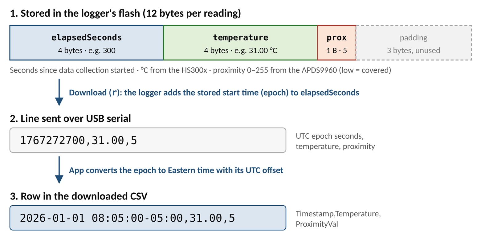

*October 2026 Ver. Prepared by Jamie Kim.*

# About this document

This is the handover record for the project *Measuring Temperature and Muscle Contraction in Custom Orthotic Devices*, specifically its splint adherence logger: a temperature and proximity logger embedded in a thermoplastic splint, and the desktop app that configures it and estimates wear time from its recordings (May 2024 – October 2026). It is composed of the following:

- **Handover summary (§1):** the state of the project at transition, open items, what to do next, and who to contact. Read this first.
- **Design decisions (§2–§7):** what was decided, why, and which alternatives were considered.
- **Testing, next steps and future directions (§8–§10):** what has been verified so far, what still needs testing or building, and the areas to explore.
- **Areas to explore (Appendices A–B):** longer notes on the two changes most worth making next.

Companion documents are listed in §1.4, and technical terms are explained under *Key terms*, after §1.

The muscle contraction variant of the project work will not be discussed as it was only explored at a preliminary level and has a different objective, where its focus is observing how much does the splint deactivate the target muscle.

**Where to start**

| If you want to… | Start with |
|--------|--------|
| Build a logger, run a deployment, or download and analyze data | The SOP (`docs/SOP_Build_and_Use.docx`) |
| Change the app or the firmware | `README.md`, then `HANDOFF.md` (developer reference), then §3–§7 of this document |
| Plan the next stage of research | §1.2, §1.3, §8–§10 and Appendices A–B |
| Understand why it works the way it does | §2–§7 |

# 1. State at transition (October 2026)

## 1.1 Current state

- **Working logger.** Arduino Nano 33 BLE Sense (nRF52840) with its built-in HS300x temperature and APDS9960 proximity sensors. It records one reading every 5 minutes to its own flash memory, for up to about 52 days of storage, and is configured and read over USB. Firmware: `collect_temperature/collect_temperature.ino`.
- **Desktop app v1.3.0.** *Splint Adherence* (Dash/Flask, opens in the browser, works offline). It initializes loggers, downloads recordings to CSV, recovers lost start times, and shows detected wear events, daily wear totals and an hour-of-day timeline. Built for Windows and macOS by GitHub Actions on each version tag, and published on the repository's Releases page.
- **Preliminary test use.** Recordings of up to about 36 days have been collected and analyzed, and the analysis was hardened against what they showed (proximity drift, §5.3). There are two loggers built, where one of them needs re-connection at the rear 3.3 V trace to update the firmware while the other one is ready for deployment. The logger that requires updated firmware has a tag attached noting that its firmware needs updating.
- **Automated application tests.** 22 automated tests (wear detection, time zones, timestamp recovery, serial protocol) run on every pull request for maintaining the application.
- **Documentation.** SOP (`docs/SOP_Build_and_Use`), developer reference (`HANDOFF.md`), README, and this document.

## 1.2 Open items (need testing)

1. **Storage bound not enforced.** `saveTemperatureReading` checks against the whole flash rather than `MAX_DATA_ENTRIES` (15 000). Records beyond about 52 days go into pages that were never erased and are never downloaded. *Test:* initialize a logger with a 1-second interval (a temporary change to `WAKEUP_INTERVAL_SECONDS` in `arduino.py`; no firmware change needed) and leave it collecting for 5 hours, well past 15 000 records. The download should stop at exactly 15 000 rows, which confirms the later readings are silently lost. After the fix, the logger should stop cleanly at 15 000.
2. **Battery life not measured** over a full deployment. Resting current was below about 750 µA on the bench. *Test:* see §1.3 step 2.
3. **Wear-detection thresholds not validated.** They were tuned by eye on a small number of recordings, with no ground-truth record of when the splint was actually worn (§5.4). *Test:* Appendix B.

## 1.3 Recommended next steps

1. Fix the firmware issues together, in one firmware release (Appendix A): wrap-safe sleep (§4.4), the storage bound (§1.2), and, ideally, starting the recording at Initialize (§4.4). Upload the updated firmware and bench test.
2. Measure full battery life: one logger on the bench for a full month or until the battery dies, which is the duration of expected battery life.
3. Collect ground truth (Appendix B): a few deployments with a wear diary or a second reference sensor. Use them to check the detection algorithm, especially on overnight wear (§5.1), and re-tune the thresholds.
4. At the end of each deployment, note the real time of the power-cycle and compare it with the last timestamp in the file. They should agree to within one interval (5 minutes); a larger gap shows clock drift or a late power-on. This costs nothing and replaces a dedicated drift test.

## 1.4 Documents & files reference

| Document | Use it for |
|----------|----------|
| `docs/SOP_Build_and_Use.md` (+ `.docx`) | Building the logger, deployments, download, analysis, troubleshooting |
| `docs/Project_Handover.md` (+ `.docx`) | This document: state, design rationale, future directions |
| `HANDOFF.md` | Developer reference: file roles, flash layout, algorithm parameters table, vendored assets, release runbook |
| `README.md` | Overview, quick start, serial protocol, data format |

| File / folder | Contents |
|----------|----------|
| `collect_temperature/collect_temperature.ino` | Logger firmware |
| `app.py`, `app_instance.py` | App entry point (routing, heartbeat shutdown), shared Dash/Flask/SocketIO objects |
| `arduino.py` | `ArduinoClient`: port search, initialize, download; participant-ID rules |
| `pages/index_page.py` | Home page: Initialize and Download flows |
| `pages/data_analysis_page.py` | Data Analysis page: plots, events table, summaries |
| `pages/analysis_helper.py` | Parsing, time zones, wear detection, timestamp recovery |
| `timezone_config.py` | Display time zone (America/New_York) |
| `tests/` | pytest suite (no hardware) |
| `setup.py` | App version and packaging settings used by the release workflow |
| `.github/workflows/tests.yml`, `build-release.yml` | Tests on every pull request; Windows/macOS builds on a `v*` tag |
| `docs/` | SOP, this document, figures (`docs/images/`), and the build script |
| `docs/build_docs.sh` | Regenerates both `.docx` files from their Markdown |

## 1.5 Handover logistics

- **Hardware location:** Room 1588, Elborn College, Western University. It may be relocated after October 2026.
- **Code and documents:** the GitHub repository (Jamie215/splint_adherence) is owned by Jamie Kim. The successor is expected to fork or clone it and continue the work in their own copy. GitHub turns off automated workflows (Actions) in a fork by default; enable them to keep the tests and the Windows/macOS builds running.
- **Questions:** reach out to Jamie Kim (jamiejmkim.jmk@gmail.com).

# Key terms

| Term | Meaning |
|-----|-----------|
| Logger / device | The Arduino Nano 33 BLE Sense board with programmed hardware, designed to be in the splint. |
| HS300x | The board's temperature (and humidity) sensor; only temperature is used |
| APDS9960 | The board's proximity/light/gesture sensor; only proximity is used. Reads 0–255, **low = something close** (splint worn) |
| Firmware | The program running on the logger (an Arduino "sketch"). Changing it means re-flashing every logger |
| Flash | The logger's built-in memory, which keeps the settings and readings without power |
| Initialize | Sending the start time and participant ID to the logger; erases the previous recording |
| Logging / idle mode | Recording with USB off / waiting for the app with USB on. Toggled on every power-up |
| Power-cycle | Turning the logger off and on |
| Serial (USB serial) | The text connection over the USB cable between the app and the logger (9600 baud). The app sends one-character commands: `?` handshake, `!` status, `i` initialize, `r` read data |
| `millis()` | The board's millisecond counter since power-on; the logger's only clock. 32 bits, so it wraps after ~49.7 days |
| Epoch | Time as seconds since 1 Jan 1970 UTC; how the logger stores the start time |
| Baseline / delta | The rolling-minimum temperature (taken as room temperature), and the temperature above it |
| Onset / offset | The start / end of a detected wear event |
| Dash / Flask | The Python web frameworks the app is built on; the app runs a local web server and opens in the browser |

# 2. Problem and goals

The goal is to measure **how consistently a patient wears a prescribed splint** — when, and for how long each day, without relying on self-report.

| Goal | Explanation |
|------|-------------|
| Objective wear time | Estimate wear periods from sensor data, not patient diaries |
| Long, unattended recording | Record for weeks with no interaction: no charging, no syncing, no app on the patient's phone |
| Simple workflow | One app to set up a logger, download it, and see the results |
| Low cost, off-the-shelf | Use a standard board with built-in sensors, so loggers are easy to build and replace |

**Scope:** wear detection from body heat and sensor covering, at 5-minute resolution, for deployments of up to about a month.

# 3. System architecture

The logger records on its own during the deployment. It only talks to a computer before (Initialize) and after (Download) a deployment, over USB serial (Figure 1).

{width=100%}

## 3.1 Record on the device, analyze on the computer

- **Design Decision:** The logger only measures and stores. All interpretation (time zones, wear detection, summaries) happens in the app.
- **Why:** This enables fine-tuning the detection algorithm as raw recordings are preserved. It also keeps the firmware small and simple, ideal for low power mode operation.
- **Alternatives:** Detecting wear on the board; streaming over Bluetooth to a phone (needs the patient's phone and consumes more power).

## 3.2 Hardware

- **Design Decision:** Arduino Nano 33 BLE Sense, using its built-in HS300x temperature and APDS9960 proximity sensors.
- **Why:** Both sensors are already on the board, so there is no extra wiring. The nRF52840 has enough flash for a month of readings and can be put into a low-power state. The board also has Bluetooth available if pursuing a wireless version in future.
- **Trade-off:** The board is larger and draws more current than a custom designed printed circuit board.

# 4. Firmware

## 4.1 Mode chosen by power-up

- **Design Decision:** The logger keeps a mode flag in flash and changes it on every power-up: an initialized logger with no data starts collecting; a collecting logger becomes idle (Figure 1).
- **Why:** During collection USB is switched off to save power, so the computer can't send a "stop" command. Power-cycling is the only control available without extra buttons.
- **Limitation:** The logger can't be seen by the app while collecting; power-cycle it first. Any reset or power loss during collection also counts as a power-up, so the recording ends there: the data so far is kept, but nothing more is recorded. Appendix A.2 describes an alternative.

## 4.2 Settings stored twice (A/B), with a checksum

- **Design Decision:** The settings (start time, interval, participant ID, mode) are kept in two flash pages. Each save writes to the page *not* holding the current copy, with a magic number, sequence number and CRC; on power-up the newest valid copy wins.
- **Why:** The earlier single-page layout could be wiped by a reset during a save, losing the start time. The A/B layout always leaves one good copy.
- **Constraint:** Loggers flashed before this change hold settings the current firmware doesn't recognize. They report `UNKNOWN` start times until re-initialized; these loggers will need to be updated to the latest firmware.

## 4.3 Low power by switching peripherals off

- **Design Decision:** During collection the firmware disables USB, UART, the radio and other unused peripherals, and waits between readings with `delay()`. Resting current measured below about 750 µA.
- **Why:** A deeper sleep (RTC2 timer + `__WFI`) was tried, but the Arduino never woke up to resume collecting data once in deep sleep; it may still be worth revisiting to further optimize battery life.

## 4.4 Fixed 5-minute interval, elapsed-time records

- **Design Decision:** One reading every 300 s (`WAKEUP_INTERVAL_SECONDS` in `arduino.py`, sent at Initialize). Each record stores seconds elapsed since collection started (from `millis()`), plus temperature and proximity, in 12 bytes; the app adds the start time.
- **Why:** The board has no real-time clock, so elapsed time is the simplest reliable record. 5 minutes resolves wear periods well enough for daily totals, and fits a month in flash. The analysis infers the real interval from the timestamps, so the interval can be changed without changing the analysis. Figure 2 shows how one reading is stored and downloaded.
- **Limitations:**
  - *Start time.* Elapsed time counts from the power-on that starts collection, while the start time is the one typed into the app at Initialize. Any gap between the two shifts every timestamp by that amount, and nothing in the file shows it. Appendix A.1 describes a fix.
  - *Rollover.* `millis()` is 32-bit and wraps at about 49.7 days, and the sleep check `nextWakeTime > currentTime` is not wrap-safe: expect a burst of readings, then a long gap. The stored elapsed times stay correct. Fix in Appendix A.3; until then, keep deployments to about a month.
  - *Clock accuracy.* Timestamps rely on the board's oscillator, with no correction. With the board's crystal (tens of ppm) the error is about 1–2 minutes a month, well under one interval; while this is not measured directly, it is a commonly known limitation of using onboard crystal (§1.3 step 4).

{width=100%}

## 4.5 Robust proximity reads

- **Design Decision:** Discard the first 2 proximity samples after the sensor wakes, and bound every wait with a timeout; a missing sensor logs `0`.
- **Why:** The first samples after wake-up are unsettled, and an unbounded wait on a faulty sensor would freeze the logger for the rest of the deployment.

# 5. Wear-detection algorithm

Full parameter table: `HANDOFF.md` §4.

## 5.1 Temperature above a rolling baseline

- **Design Decision:** Take room temperature as the rolling minimum over about 2 hours, and look at the rise above it (delta). An event starts when the proximity sensor is covered, the temperature has risen over the last ~15 minutes, and either the jump is ≥ 0.8 °C in one sample or the rise is ≥ 3 °C. It ends when the proximity sensor is uncovered, or the temperature is falling fast (≥ 0.4 °C per sample) and is near baseline or below 80 % of the event's peak rise.
- **Why:** Room temperature changes over the day, so a fixed threshold would fail; the rolling minimum follows it. The 15-minute trend check stops cooling slopes from triggering false onsets.
- **Limitation:** After about an hour of continuous wear the 2-hour window holds only "worn" samples, so the baseline rises to skin temperature and delta falls to about 0. From then on, a single drop of 0.4 °C between samples ends the event, and it cannot restart (that needs delta ≥ 3 °C or a jump ≥ 0.8 °C). On synthetic 8-hour overnight wear, noise with a standard deviation of 0.15 °C split the nights into short pieces; with 0.04 °C they were detected whole. Possible fixes are in Appendix B.2.

## 5.2 Proximity as a gate

- **Design Decision:** Use the proximity sensor only to confirm "covered", not to detect wear on its own.
- **Why:** Temperature alone can't tell wear from a warm environment (e.g. the splint left on a radiator or in the sun); the covered sensor rules those out.

## 5.3 Drift-invariant "covered"

- **Design Decision:** Track the proximity floor as the rolling 10th percentile over about a day, subtract it, and call the sensor covered when the remainder is within the noise (`max(5, 4 × MAD)`, where MAD is the median absolute deviation).
- **Why:** On a 35-day recording the proximity reading while worn crept from 0 into the 50s as the battery discharged. The original test (`prox == 0`) stopped working after about 11 days, and wear was missed from then on.

## 5.4 Thresholds are empirical

All thresholds were set by inspecting a small number of recordings. A finer tuning may be required based on the larger sample data. Appendix B describes further on how.

# 6. Time handling

- **Design Decision:** The logger knows only UTC epoch seconds. The app asks for and shows **Eastern time** (America/New_York, daylight-saving aware) everywhere, and writes timestamps with their UTC offset (e.g. `-04:00`).
- **Why:** The study runs in Ontario. The offset keeps the repeated hour at the November change unambiguous, and durations across the change come out right.
- **Recovery:** If a logger loses its start time, the elapsed times survive. The app detects such files and rebuilds the timestamps from a start time the user enters, during download or on the Data Analysis page.
- **To change the zone:** edit `timezone_config.py`.

# 7. Desktop application

- **Browser-based interface (Dash + Flask-SocketIO).** Plotly/Dash provide the charts and tables; the app runs a local server on `127.0.0.1:8050` and opens the browser.
- **Heartbeat shutdown.** The page sends a heartbeat every 5 s. With none for 5 minutes, the server warns the page and exits, so closing the tab doesn't leave a hidden server holding the serial port for data privacy.
- **Works offline.** All required assets are packaged, allowing the application to be usable in offline conditions as well.
- **Automated releases.** GitHub Actions builds stand-alone Windows and macOS programs on each `v*` tag, with Python included, so staff need no Python (SOP Appendix B).
- **Participant IDs.** Letters, digits, `-` and `_`, up to 15 characters: they go into the CSV header and often into file names, where commas or spaces would cause trouble.

# 8. Testing and validation to date

| Area | Status |
|----------|----------|
| Logging over a deployment | Recordings up to ~36 days collected and analyzed |
| Resting current | Below ~750 µA on the bench |
| Proximity drift | Seen on a 35-day recording; handled in analysis (§5.3), covered by a test |
| Analysis code | 22 automated tests (detection, drift invariance, DST, legacy files, recovery, serial parsing) |

# 9. Next steps

What still needs testing, and the changes that should come next. §1.3 gives the recommended order.

| Item | Status | What to do |
|--------|--------|-------------|
| Battery life | Not measured | One logger on the bench for a full month or until the battery dies (§1.3) |
| Storage bound (~52 d) | Predicted from code | 1-second-interval test (§1.2), then the firmware fix (Appendix A.3) |
| Clock rollover (~49.7 d) | Predicted from code | Wrap-safe sleep and an offset test across the wrap (Appendix A.3) |
| Wear-detection accuracy | Not validated against ground truth | Collect ground truth and re-tune, including long-wear handling (Appendix B) |
| Clock drift | Not measured; expected negligible (§4.4) | Compare the end-of-deployment power-cycle time with the last timestamp (§1.3) |
| Firmware robustness | Not started | Start collection at Initialize; optionally, choose idle/collection by USB presence (Appendix A) |
| Battery monitoring | Not started | Log the battery voltage with each reading, so a dying battery shows in the data |

# 10. Directions to explore

| Area | Recommendation |
|-------|---------------|
| Wireless download | Use the board's Bluetooth to download without opening the splint; adds power and pairing complexity |
| Real-time clock | An external RTC would remove the start-time dependence on power-on and the rollover limit |
| Custom printed circuit board | Only the parts needed (microcontroller, temperature and proximity sensors, power regulation) on a board shaped for the splint: smaller, lower current, and better sensor placement against the skin. Needs hardware design and validation |

# Appendix A — Firmware robustness

**Status:** Identified from the code (§1.2 item 1; §4.1; §4.4). Not yet implemented.

## A.1 Start the recording at Initialize

Today the logger powers down at Initialize and starts counting time at the *next* power-on, so the start time is only right if it is powered on at the entered minute. Two ways to remove this:

- **Start at Initialize, from the computer's clock.** The app sends "now" and the logger starts collecting immediately (no power-down). The start time is then exact, but the scheduled start goes away.
- **Keep the scheduled start, but count from Initialize.** The logger stays on in low power after Initialize and starts collecting when the entered start time arrives. Also exact, at the cost of a little battery between Initialize and the start. This keeps today's workflow.

## A.2 Idle vs. collection by USB presence (optional)

Choose the mode at power-up by whether USB power is present (the nRF52840 reports this), instead of toggling on every power-up:

- USB connected → idle, answer the app.
- No USB → if initialized, start or **resume** collection, appending after the last record.

This makes a reset during a deployment cost only a gap instead of the rest of the recording, and the logger no longer needs a power-cycle before download. Resuming needs the elapsed time to continue across the reset, e.g. by storing a reset counter and leaving a marker row in the data.

## A.3 Timing and storage

- Wrap-safe sleep: `if ((int32_t)(nextWakeTime - currentTime) > 0)`. Test across the wrap with a temporary offset of about 2³² − 10 min added to `millis()` in the logging path.
- Stop at `MAX_DATA_ENTRIES` in `saveTemperatureReading`, or erase all the pages that may be written.

## A.4 Next steps

Implement A.3 first (small, low risk), then A.1, bench-test for a full month, and update the SOP (§1.1, §6, §7).

# Appendix B — Ground truth and re-tuning the detector

**Status:** Needed before wear times are reported as results.

## B.1 Collecting ground truth

- **Wear diary:** the participant (or staff, in a supervised session) records on/off times. Cheap, but coarse and subject to the same recall bias the logger is meant to avoid.
- **Supervised sessions:** scripted on/off periods in the lab, including long continuous wear and confounders (warm room, splint left on a warm surface, covered but not worn).
- **Reference sensor:** a second, independent sensor (e.g. a commercial temperature button logger on the skin side) for a few deployments.

## B.2 What to check

- Per-event agreement (onset/offset within ±1 sample) and per-day wear minutes.
- **Long wear:** whether overnight wear is split or cut short (§5.1). Possible fixes: a longer baseline window, freezing the baseline while an event is in progress, or requiring two consecutive cooling samples before ending an event.
- False positives in warm environments, and false negatives with a loose splint.

## B.3 Next steps

Add each labelled recording to `tests/` as a regression case, then re-tune the thresholds in `detect_onsets_offsets` against them and record the new values in `HANDOFF.md` §4.
