*Drafted in October 2026, prepared by Jamie Kim.*

# 1. Purpose and scope

This SOP describes how to build the splint adherence logger, set up its software, deploy it with a participant, and download and analyze the recording. It covers the system as it currently exists: an Arduino-based logger embedded in a thermoplastic splint, configured and read over USB by a desktop application.

**How it works.** A small board in the splint wakes up every 5 minutes, measures temperature and how close something is to its proximity sensor, writes both to its own memory, and goes back to sleep. When the splint is worn, the skin warms the temperature sensor and covers the proximity sensor. After the deployment, the desktop application downloads the recording and estimates when, and for how long, the splint was worn.

Key terms used in this SOP:

- **Logger / device.** The Arduino board in the splint, with its temperature and proximity sensors.
- **App.** The desktop program *Splint Adherence* (Windows or macOS). It opens in your web browser but runs entirely on your computer; no internet connection is needed.
- **Firmware / flashing.** The program that runs on the logger, and loading it onto the board (§3.2).
- **Initialize.** Sending a start time and participant ID to the logger from the app. This erases any recording still on the logger (§5).
- **Data collection / idle.** The logger is either recording (data collection, invisible to the computer) or waiting for the app (idle). It switches between them each time it is powered on (§1.1).
- **Power-cycle.** Turning the logger off and on again: unplug the coin cell and plug it back in.
- **Participant ID.** Up to 15 letters, digits, `-` or `_` (no spaces), e.g. `SA-014`. It is stored on the logger and in the downloaded file.
- **Wear event.** A period the app judges the splint was worn, from the temperature rise and the covered proximity sensor.

## 1.1 The logger's four states

What the logger does when it is powered on depends on its current state (Figure 1).

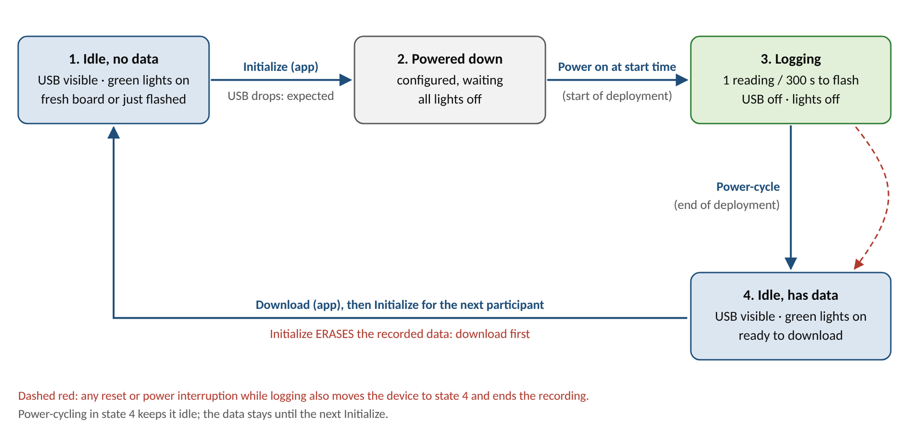{width=100%}

| State | Lights | Visible to the app? | Reached by |
|--------|--------|--------|-----------|
| 1. Idle; not initialized | Green on | Yes | Flashing the firmware |
| 2. Idle; initialized | Off (powered down) | No | Initialize in the app, from state 1 or 4 |
| 3. Data collection | Brief flash at power-on, then off | No | Powering on after Initialize |
| 4. Idle; collection complete | Green on | Yes | A power-cycle or any reset during data collection |

Keep in mind:

- The app cannot see a logger that is collecting data. Power-cycle it first to reach state 4.
- **Any reset or power loss** during a deployment, such as a loose coin cell, ends the recording for good.
- Initializing **erases the previous recording**, so download it first (§7).
- Timestamps count from the power-on that starts data collection, so power on at the start time entered in the app (§5).

> **Safety and use limits.** This is a research prototype worn against the skin. It runs on a CR2450 coin cell: keep spare and used cells away from children, as a swallowed coin cell can cause serious internal injury. The skin-contact face of the case is covered with skin-friendly tape, renewed for every deployment. Check the skin under the case at each visit.

# 2. Building the device

To assemble the device, you need the following materials and equipment. The assembly involves sharp tools and soldering: follow the safety instructions for each piece of equipment, wear the appropriate personal protective equipment, and work in a well-ventilated area.

| Qty | Item | Notes |
|----|------------|--------------------|
| 1 | Arduino Nano 33 BLE Sense Rev2 | Microcontroller with onboard sensors, including the HS300x temperature sensor and the APDS9960 proximity sensor |
| 1 | CR2450 coin cell battery | Use a new cell for every deployment |
| | Red silicone-covered stranded-core wire (diameter 1.52 mm) | Does not have to be this exact specification, as long as it fits the Arduino Nano 33 BLE Rev2 pins. Connects the coin cell holder to the Arduino's 3.3 V pin |
| | Black (or blue) silicone-covered stranded-core wire (diameter 1.52 mm) | Does not have to be this exact specification, as long as it fits the Arduino Nano 33 BLE Rev2 pins. Connects the coin cell holder to the Arduino's GND (ground) pin |
| | Wire cutter and stripper | Used to prepare the connection wires |
| | Solder | |
| | Solder flux | Helps the solder stick to the joints. Optional |
| | Soldering iron | |
| | Helping-hands soldering stand | Holds parts while soldering. Optional |
| | Tweezers | Used to hold the wires and parts. Optional |
| | Kapton tape | Protects the bottom of the board |
| 1 | Fielect CR/LIR2450 horizontal coin button battery holder | Holds the CR2450 that powers the Arduino. If another battery holder is used, the case may need a redesign |
| | Multimeter | Used to check the soldered joints |
| 1 | 3D-printed case | Printed from `splint_adherece_case.stl` in the repository. MSK-IF used PLA as the filament material |
| 1 | Clear acrylic window, 1 mm thick (1 cm × 1 cm) | Lets the APDS9960's infrared light pass through. Needs to be cut from a 1 mm sheet; sheets are available in Rm 1588, Elborn College |
| | Acrylic (plexiglass) sheet cutter | Used to cut the window; available in Rm 1588, Elborn College |
| | Super glue | Glues the window to the case |
| | Cotton swab (Q-tip) | Spreads or cleans up excess glue around the window |
| | EVA foam | Used to fill the gap between the Arduino and coin cell holder when folded; Optional |
| 2 | Chicago screws | Secure the case through the thermoplastic splint (§6). Depending on how securely the case sits in the moulded splint, the screws may be optional |
| 1 | Skin-friendly tape | Covers the skin-contact face of the case; renewed every deployment |

## 2.1 Power wiring

1. Cut the red and the black (or blue) wire to about 25 mm each. Adjust the length for your wire type.
2. Using the wire stripper, strip both ends of each wire (about 3 mm).
3. Locate the 3.3 V pin (**3V3**) and the ground pin (**GND**) on the Arduino.

   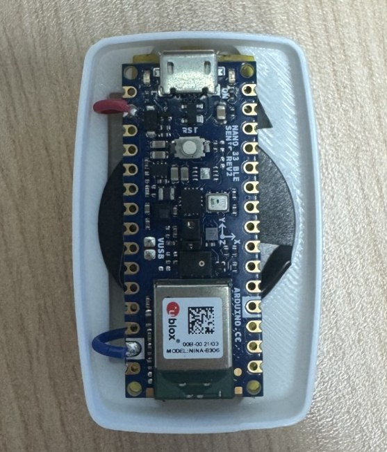{width=40%}

4. Insert one end of the red wire into the 3V3 pin and solder the joint from the top, at a suitable soldering-iron temperature (e.g. 580 °F, about 305 °C; follow your solder's datasheet). Use solder flux, helping hands and tweezers as needed.
5. Insert one end of the black (or blue) wire into the GND pin and solder it the same way.
6. Once both joints are secure, trim the excess solder underneath so the bottom of the board sits flat.
7. Solder the other ends to the battery holder's pins: red wire to "+", black (or blue) wire to "−".

   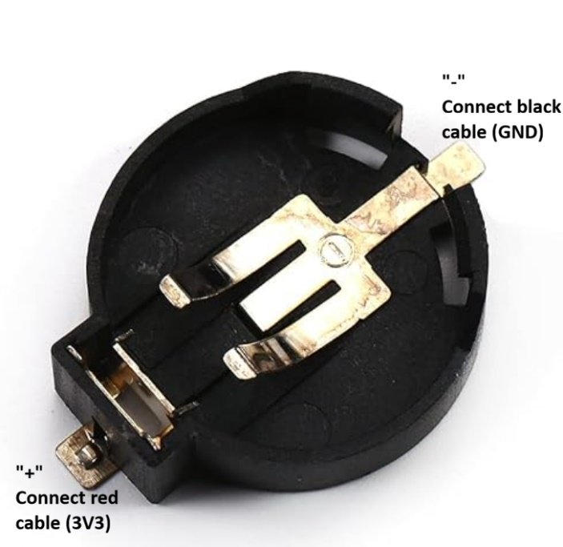{width=50%}

8. Insert a CR2450 to check that the Arduino is powered, and use the multimeter across the joints to check the voltage. **Remove the battery** once the test is complete.
9. Apply Kapton tape to the bottom of the board for protection.

   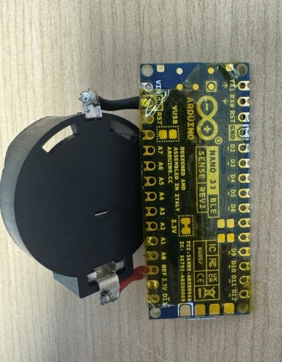{width=35%}

## 2.2 Case

1. 3D print the case from `splint_adherece_case.stl`, in a material of your choice. PLA was used during MSK-IF development.
2. Prepare a clear acrylic (plexiglass) window, 1 cm × 1 cm.
3. From the inside, slide the window into the opening in the middle of the lid. It should slide easily between the printed rails. Make sure it fully covers the opening.

   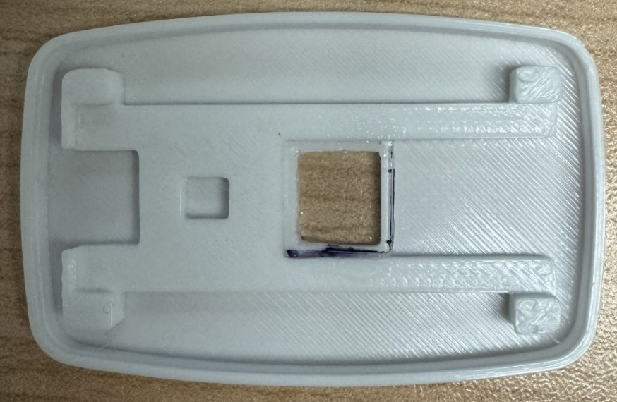{width=60%}

4. Apply a small amount of super glue to the raised edges of the opening, place the window directly on top, and remove any excess glue with a cotton swab. Keep the centre of the window free of glue.
5. Let the glue harden so the window is held securely inside the lid.
6. Test-fit the soldered board from §2.1 as in Figure 2. Fold it so the positive (+) side of the battery faces the bottom of the case and the top of the Arduino faces the lid. Use the extra space on the left for the wires, so the Arduino sits flat.
7. Close the lid, with its micro-USB groove lined up with the Arduino's micro-USB socket. The proximity sensor (APDS9960) should sit directly under the window (Figure 6). Then open the lid again: the case is closed for good at deployment (§6).

   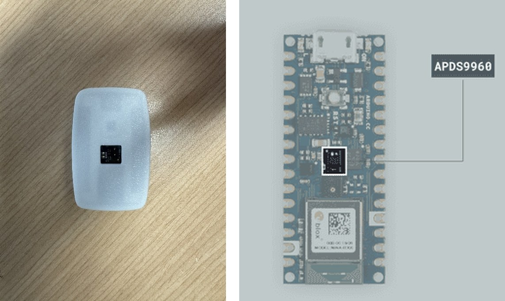{width=60%}

   If the proximity sensor sits tilted because of the gap between the Arduino and the coin cell holder, place a thin piece of non-conductive EVA foam in the gap so the sensor sits flat under the window.

Once done, label each logger (e.g. with a device number) so recordings can be matched to devices.

# 3. Software setup

## 3.1 Firmware tools

The Arduino IDE is a program used to load the firmware onto the logger.

1. Install the Arduino IDE (version 2.x) from arduino.cc.
2. Open **Tools → Board → Boards Manager**, search for **Arduino Mbed OS Nano Boards** and click **Install**. On Windows, accept the driver installation if asked.
3. Open **Tools → Manage Libraries**, then search for and install **Arduino_APDS9960** and **Arduino_HS300x**.

## 3.2 Flashing the logger

> **Remove the coin cell before connecting USB** whenever the 3.3 V jumper on the back of the board is intact or bridged. With the jumper closed, the board's own 3.3 V supply would push current into the coin cell, which is not rechargeable.

1. Download the project files from the repository (https://github.com/Jamie215/splint_adherence): green **Code** button → **Download ZIP**, then unzip.
2. Connect the logger to the computer by USB (no coin cell). In the Arduino IDE, open `collect_temperature/collect_temperature.ino`.
3. Select the board **Arduino Nano 33 BLE** and its port (**Tools → Port**), then click **Upload** (→ arrow). Wait for **Done uploading**.

   If the upload fails or no port is listed: check that the cable is a data cable and try another USB port. If it still fails, press the board's reset button twice quickly (the orange light pulses slowly, meaning it is ready to be flashed), then click **Upload** again.

4. After flashing, the board restarts in state 1 (idle; not initialized): the green light is on.
5. Optional check: open **Tools → Serial Monitor** (9600 baud). The board prints **Ready for Connection** when it restarts. Type `?` and press Enter: it replies **Hello World!**. Close the Serial Monitor afterwards, because only one program can use the connection at a time.
6. Disconnect the micro-USB cable, then **cut the 3.3 V jumper trace** on the back of the board (Figure 7). This stops the board's regulator and USB circuitry from drawing power, which keeps the resting current low (below about 750 µA).

   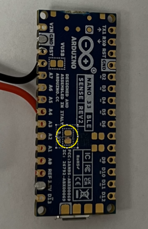{width=30%}

With the jumper cut, USB alone does not power the logger: the coin cell must be connected whenever the logger is used with the app (Initialize, Download). To update the firmware after the jumper has been cut, first bridge the 3.3 V jumper with a small solder bridge, remove the coin cell, and repeat steps 2–6 of this section.

## 3.3 Installing the app

1. Open the project's **Releases** page (https://github.com/Jamie215/splint_adherence/releases) and, under **Assets** of the latest release, download:
   - Windows: `Splint_Adherence-windows.zip`
   - macOS: `Splint_Adherence-macos.zip`
2. Unzip it to a folder you can write to (e.g. `Documents\Splint_Adherence`).
3. Start it:
   - **Windows:** open the `Splint_Adherence` folder and double-click `app.exe`. The first time, Windows may show **Windows protected your PC**, because the program is not signed by a publisher. Click **More info**, then **Run anyway**.
   - **macOS:** right-click `Splint_Adherence.app` → **Open**, then confirm. (A plain double-click is blocked the first time because the app is not signed.)
4. After a few seconds the app opens in your web browser at `http://127.0.0.1:8050` (Figure 8).

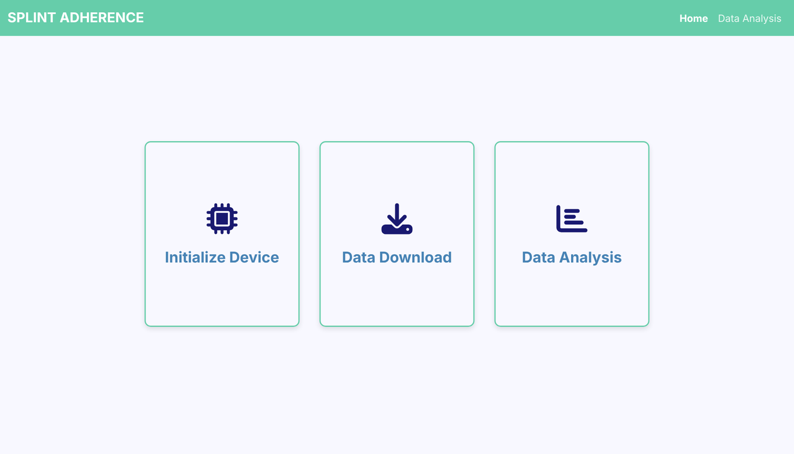{width=80%}

Keep the browser tab open while you use the app. The app runs only while its tab is open. About 5 minutes after the tab is closed it shuts itself down; you will have to start it again to continue.

To update the app later, download the newer release and replace the old folder.

# 4. Pre-deployment checklist

- [ ] The logger is flashed with the current firmware (§3.2).
- [ ] Any previous recording on this logger has been **downloaded and checked** (§7). Initializing will erase it.
- [ ] A **new** CR2450 coin cell is ready for this deployment.
- [ ] The 3.3 V jumper on the back of the board is cut (§3.2).
- [ ] The skin-friendly tape on the case has been renewed.
- [ ] With the coin cell connected, the logger is idle (green light on). If not, power-cycle it once.
- [ ] A micro-USB data cable is at hand, and the Arduino Serial Monitor (or anything else using the logger's port) is closed.
- [ ] The participant ID and the planned start date and time are decided.
- [ ] The deployment is planned to last **no longer than about one month** (§6).

# 5. Initializing a logger

Initializing tells the logger its participant ID and when its recording starts, erases the previous recording, and powers it down, ready for the deployment.

1. Connect the coin cell, then connect the logger (idle, green light on) by USB. **The cell must stay connected**: USB alone does not power the logger.
2. In the app, click **Initialize Device**, then **Connect**. If you see **No device found** (Figure 9), see §10.
3. Fill in the form (Figure 10):
   - **Date**, **Hour (ET)** and **Minute**: when the logger will be powered on to start collecting data, in Eastern time on a 24-hour clock, whatever time zone the computer is set to. It defaults to now, and can be up to 60 days ahead.
   - **Participant ID**: up to 15 letters, digits, `-` or `_`, e.g. `SA-014`. An invalid ID is flagged in red, and Initialize does nothing until it is fixed.
4. Click **Initialize**. The confirmation shows the start time (Figure 11). The logger has now powered down (all lights off) and its USB connection drops; **this is expected**.
5. Disconnect USB and unplug the coin cell. To prepare another logger, connect it and click **Initialize Another**.
6. Record the device label, participant ID and start time in the deployment log.

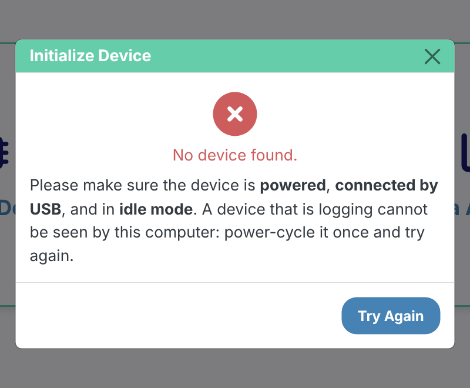{width=55%}

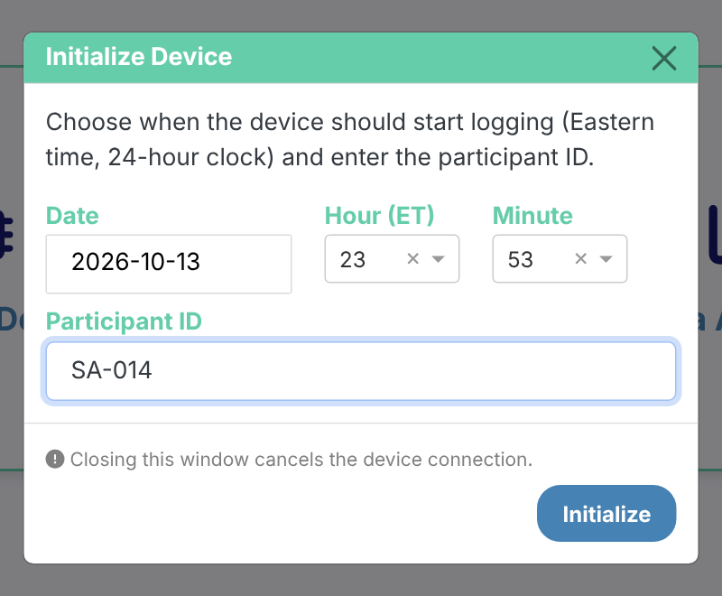{width=55%}

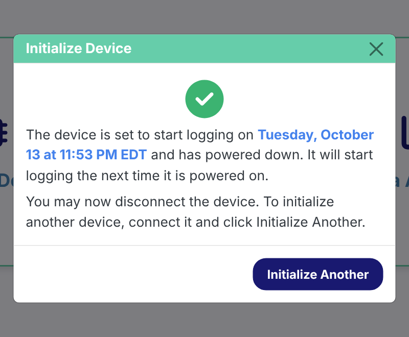{width=55%}

> **The start time must match the moment the logger is powered on.** The logger does not have a real clock. It stores the start time you entered and counts the seconds from the moment it is next powered on. If it is powered on at 14:20 but the start time entered was 14:00, every timestamp in the recording will be 20 minutes early. Power it on at the entered time, as closely as you can (§6).

# 6. Deployment

1. At the start time entered in §5, connect a **new** CR2450 coin cell. Note the actual time in the deployment log.
2. The lights come on briefly, then go off when the first reading is taken; after that the logger stays dark. (A logger left with its green light on is idle, not collecting data: re-check §5.)
3. Fit the device into its case and close the lid, as in Figure 6.
4. Secure the case into the participant's splint with the Chicago screws, with fresh skin-friendly tape on the skin-contact face.
5. Give the participant their instructions, based on the study protocol (e.g. wearing schedule, keeping the splint away from moisture, and what to do if the device is knocked or comes loose).

> **Note.** Plan deployments for **about one month at most**. The longest full recording tested lasted about 36 days. With the current firmware, the logger's internal timer rolls over at around 49.7 days, and its sampling can get affected. Also, the onboard storage becomes full about after 52 days (15000 readings at one every 5 minutes).

# 7. Downloading data

## 7.1 Download

1. At the end of the deployment, power-cycle the logger once (unplug the coin cell and plug it back in) to bring it to state 4 (green light on; Figure 1). Note the real time of the power-cycle in the deployment log.
2. With the cell still connected, connect the logger by USB. In the app, click **Data Download**, then **Connect**.
   - **This device has not been initialized…**: the logger holds no recording.
   - **No device found**: see §10.
3. Enter a **File name** (Figure 12). The placeholder shows the naming convention `Subject(UID)_(Quarter).(DeviceIteration)`, e.g. `SA014_Q3.1`. Do not add `.csv`; the app adds it.
4. Click **Download Data**. A full month takes about a minute; keep the window open until **Download complete** appears (Figure 13).

   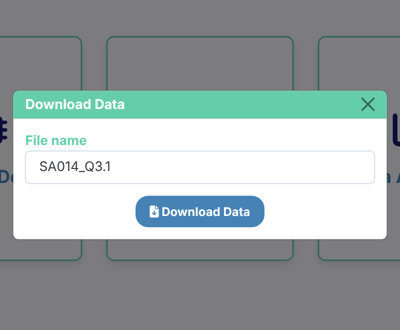{width=55%}

   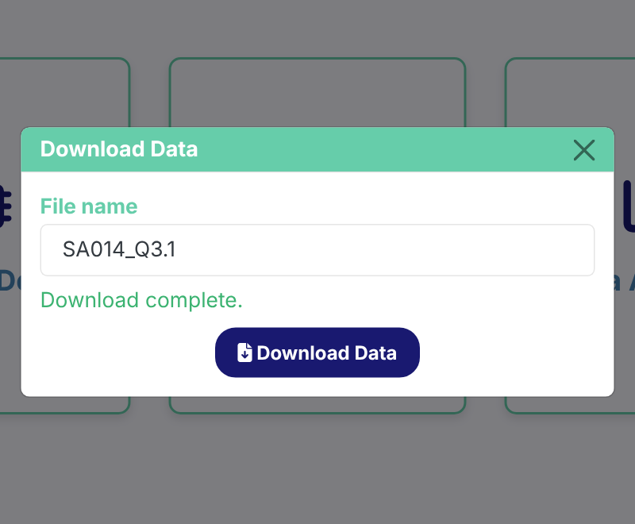{width=55%}

5. The file is saved through the browser, normally to your Downloads folder. Move it to the study's data storage.
6. Open it on the **Data Analysis** page (§8) to check that it looks complete before the logger is initialized again. Alternatively, you can manually inspect the downloaded CSV file.


Closing the modal window releases the logger. Power-cycling the logger in idle mode keeps it idle; the recording stays on it until the next Initialize.

## 7.2 If the start time is missing

If the logger lost its settings (for example after re-flashing, §3.2), the readings and the time between them are intact but the start time is not. The app then shows **Start time missing** during download (or **Start Time Missing** on the Data Analysis page; the timestamps would otherwise show dates in 1970 or 2106).

1. Enter the start date and time (Eastern) that was used when the logger was initialized (from the deployment log).
2. During download, click **Save Corrected File**; the file is saved under the name you entered. On the Data Analysis page, click **Rebuild Timestamps**, then **Download Corrected CSV**; that copy is named `<original name>_recovered.csv`.
3. If the start time is not known yet, click **Save Without Correcting**; it can be rebuilt later on the Data Analysis page.

# 8. Analyzing data

1. Click **Data Analysis** (home page or top bar), then drag the CSV file onto the box, or click **select a file**.
2. The page shows (Figures 14–17):
   - **File Information**: the start time, sampling interval, participant ID and time zone from the file.
   - **Detected Wear Events**: the temperature (black), its rolling minimum baseline (blue), the temperature rise above that baseline (green), and the proximity value (red); detected wear periods are shaded. The table lists each event's start, end, duration and peak temperature.
   - **Daily Wear Summary**: average non-peak and peak temperature, total wear time, average wear time per day, and a bar chart of wear minutes per day.
   - **Wear Periods by Hour of Day**: one column per day showing when the splint was worn.
3. Use the buttons above each chart to zoom, pan, reset the view, or save a picture (camera icon).

All times are Eastern time, with daylight-saving changes handled. The screenshots below use simulated data, so real recordings will look less regular.

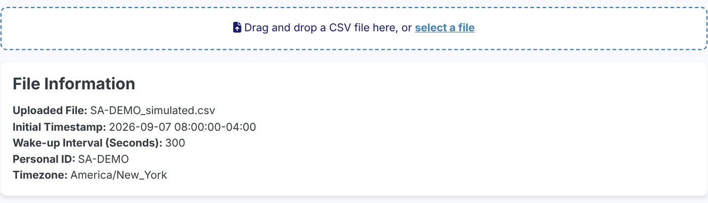{width=100%}

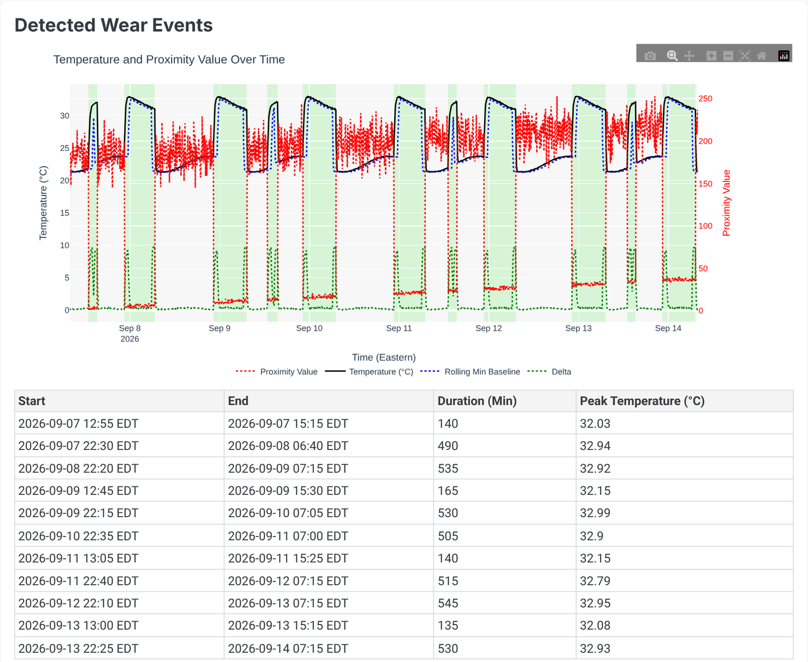{width=100%}

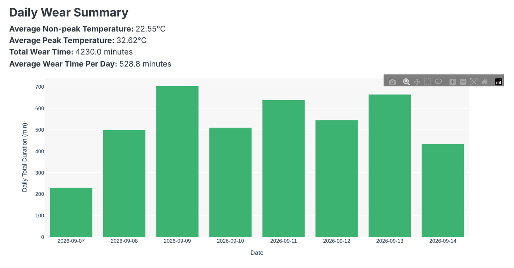{width=100%}

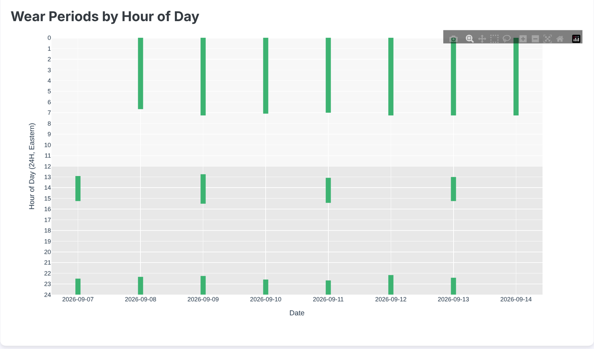{width=100%}

> **Treat the detected wear times as estimates.** The detection thresholds were tuned on a small amount of data and have not been checked against a record of when the splint was really worn. Long continuous wear (e.g. overnight) may be split or cut short (Project Handover, §5.1). Look at the traces, not only the totals. Appendix C describes how to re-tune the detection.


# 9. Data handling

Each download is one CSV file, which opens in Excel:

```
Initial Timestamp,2026-01-01 08:00:00-05:00
Wake-up Interval (Seconds),300
Personal ID,SA-014
Timezone,America/New_York
Timestamp,Temperature,ProximityVal
2026-01-01 08:00:00-05:00,30.50,0
2026-01-01 08:05:00-05:00,31.00,5
...
```

| Column | Meaning |
|------|--------------------|
| `Timestamp` | Eastern time with its UTC offset (`-05:00` standard time, `-04:00` daylight time) |
| `Temperature` | °C, from the HS300x sensor |
| `ProximityVal` | 0–255 from the APDS9960 sensor; low = covered (worn). Its baseline creeps upward over a long deployment; the analysis allows for this. |

- Keep a deployment log: device label, participant ID, firmware/library versions, start time entered, actual power-on time, actual power-cycle (end) time, file name, and notes (device knocked, battery changed, splint removed for long periods, skin issues).
- Keep the original download untouched; if modified (i.e., corrected), save any copy alongside it.
- Use a study code, not a name, as the participant ID: it is stored on the logger, in the file and often in the file name.
- The PI and research team will need to plan for data governance and where study data are stored and who can access them (participant data). No policy exists yet; see Project Handover §1.2 item 4.

# 10. Troubleshooting

| Symptom | Likely cause | Action |
|----------|----------|-------------|
| **No device found** | Logger is still collecting data (most common), or not connected | Power-cycle the logger once (press the reset button once, or unplug and replug the coin cell), check the green light is on, reconnect, click **Try Again** |
| **No device found** and no lights at all | Coin cell not connected or flat: USB alone does not power the logger | Connect a coin cell (a new one if in doubt), then retry |
| **No device found** with the green light on | Charge-only cable, loose cable, or another program (Arduino Serial Monitor) is using the port | Use a data cable, try another USB port, close the Serial Monitor |
| "This device has not been initialized…" on download | The logger has no recording | Nothing to download; check you have the right logger |
| Initialize shows an error | Connection dropped before the settings were sent, or the logger rejected them (corrupted message) | Click **Try Again**; if it repeats, power-cycle the logger and retry |
| Initialize does nothing | Participant ID is empty or has spaces or other characters | Use letters, digits, `-` or `_` only (max 15) |
| Start time `UNKNOWN`, or dates in 1970 / 2106 | The logger lost its settings (usually re-flashed over old firmware) | Rebuild the timestamps from the deployment log (§7.2) |
| Recording shorter than expected | The logger was reset or lost power during the deployment (it then stops collecting data) | Check the coin cell and its connector; note it in the log |
| All timestamps shifted by a fixed amount | The logger was powered on at a different time than the start time entered | Record the actual power-on time in the deployment log and report the offset with the data; the app has no correction tool for this |
| Burst of readings or a long gap near day 49–50 | Timer rollover (§6) | Use data before day ~49 only |
| Little or no wear detected although the splint was worn | Sensors not against the skin, or a weak temperature rise | Check mounting (§2.2); look at the raw traces |
| Browser shows **Interface Terminated** | The app shut down after its tab was closed or idle | Close the tab and start the app again |
| Page looks unstyled, or icons are missing | Old app version | Download the latest release (§3.3) |
| "Windows protected your PC" / macOS "cannot be opened" | The app is not signed | Windows: More info → Run anyway. macOS: right-click → Open. If IT policy blocks it, ask IT to allow it |
| Arduino IDE upload fails / no port | 3.3 V jumper not bridged, charge-only cable, faulty port, or the board is busy | Bridge the jumper and remove the coin cell (§3.2); data cable, another port; double-press reset and upload again |

# 11. After the deployment

1. Download the recording (§7) and check it on the **Data Analysis** page (§8).
2. Store the CSV with the deployment log (§9).
3. Unscrew the case from the splint.
4. Remove the coin cell and dispose of it safely, out of reach of children.
5. Wipe the case, remove the old skin-friendly tape, and apply new tape before the next deployment.
6. Note any problems (lights, error messages, short recordings) in the deployment log.

# Appendix A. Running the app from Python (optional)

You only need this to change the app, to run the tests, or to use a system without a ready-made build.

1. Install Python 3.11 or newer from python.org. On Windows, tick **Add Python to PATH**.
2. Open a terminal in the project folder (the one containing `app.py`).
3. Run, one line at a time:

   Windows (Command Prompt):

   ```
   python -m venv .venv
   .venv\Scripts\activate
   pip install -r requirements.txt
   python app.py
   ```

   macOS / Linux:

   ```
   python3 -m venv .venv
   source .venv/bin/activate
   pip install -r requirements.txt
   python app.py
   ```

4. The app opens in the browser as in §3.3.

**Next time**, open a terminal in the project folder, run the activate line again, then `python app.py`.

**Tests** (no logger needed): `pip install -r requirements-dev.txt`, then `pytest`. All tests should pass.

# Appendix B. Releasing a new app version (for developers)

The Windows and macOS builds are made automatically by GitHub Actions when a version tag is pushed. This needs Git, a clone of the repository (not the ZIP), and write access to it.

1. Check the change locally: `pytest`, then `python app.py` and run through Initialize, Download and Data Analysis with a logger if possible.
2. Bump `version` in `setup.py` (small fix `1.3.1`, new feature `1.4.0`, a change to the CSV format `2.0.0`) and merge to `main`.
3. Tag and push (replace the version):

   ```
   git checkout main
   git pull
   git tag v1.3.1
   git push origin v1.3.1
   ```

4. In the repository's **Actions** tab, the **Build and Release** run builds both versions and attaches `Splint_Adherence-windows.zip` and `Splint_Adherence-macos.zip` to the new release. Edit the release notes to say what changed. If the run fails, fix the problem and use a new version number.
5. To test a build without releasing: **Actions → Build and Release → Run workflow**; the zips appear as downloads on the run's page.

Firmware changes (`collect_temperature.ino`) are not part of the app release: every logger must be re-flashed (§3.2), after downloading its data.

# Appendix C. Tuning the wear-detection parameters (for analysts and developers)

The rules that use temperature and proximity values to estimate wear events were set by inspecting a small number of recordings (Project Handover, §5). Re-tune them once there are recordings with a known record of actual wear ("ground truth"). The parameters are constants in the code (`pages/analysis_helper.py`) with no setting in the app, so a change needs the Python version (Appendix A) and a new app release (Appendix B).

## C.1 Collect ground truth

- **Wear diary:** the participant (or staff, in a supervised session) records on/off times.
- **Supervised sessions:** scripted on/off periods in the lab, including long continuous wear and confounders (warm room, splint left on a warm surface, sensor covered but splint not worn).

## C.2 What to check

- Agreement per event (start and end within one 5-minute reading) and per day (total wear minutes).
- **Long wear:** whether overnight wear is split or cut short. After about an hour of continuous wear the baseline catches up with skin temperature, and a single 0.4 °C dip can end the event. Possible fixes: a longer baseline window, freezing the baseline while an event is in progress, or requiring two consecutive cooling readings before ending an event.
- False wear in warm environments, and missed wear with a loose splint.

## C.3 Parameters

| Parameter | Where | Value | Raising it will… |
|------------|---------------|------|-------------------|
| `ONSET_DELTA` | `detect_onsets_offsets` | 3.0 °C | require more heat above room temperature to start an event (fewer false events; gentle onsets missed) |
| `ONSET_GRAD` | `detect_onsets_offsets` | 0.8 °C/reading | require a sharper jump to start an event |
| `OFFSET_GRAD` | `detect_onsets_offsets` | −0.4 °C/reading | (less negative) end events on gentler cooling |
| `OFFSET_DELTA` | `detect_onsets_offsets` | 1.5 °C | end events while still further above room temperature |
| `PEAK_DROP_FACTOR` | `detect_onsets_offsets` | 0.8 | end events after a smaller drop from the peak |
| Baseline window | `detect_onsets_offsets` | ~120 min | give a steadier room-temperature estimate, but slower to follow room changes |
| Trend lag | `detect_onsets_offsets` | ~15 min | smooth the "is it warming up" check more |
| Minimum length | `detect_onsets_offsets` | 2 readings | drop more short events |
| Floor window | `dedrift_proximity` | ~1 day | follow proximity drift more slowly |
| Floor quantile | `dedrift_proximity` | 0.10 | raise the proximity floor estimate |
| `k` | `dedrift_proximity` | 4.0 | allow more noise and still call the sensor covered |
| `min_excursion` | `dedrift_proximity` | 5.0 | raise the minimum threshold for "not covered" |

## C.4 Procedure

1. Change one parameter at a time in `pages/analysis_helper.py`.
2. Run `pytest`; all tests should still pass.
3. Start the app from Python (`python app.py`) and open each labelled recording on the Data Analysis page. Compare the detected events and daily totals with the ground truth.
4. When the results improve, add each labelled recording to `tests/` as a regression case, so later changes can't silently undo the improvement.
5. Record the new values in `HANDOFF.md` §4.
6. Release a new app version (Appendix B). Older downloads can simply be re-opened in the new version, since the raw readings are unchanged.

# Appendix D. Checking clock drift (bench test)

The logger keeps time with its own clock, with no correction. Its drift is expected to be negligible (about 1–2 minutes a month; Project Handover §4.4). This one-off bench test measures it. It is not part of a deployment: it needs a known stop time while the battery is still good.

1. Fit a new CR2450 and initialize the logger (§5) with a start time a few minutes ahead.
2. Connect the coin cell exactly at that start time, read from a reliable clock (e.g. a phone set to automatic network time).
3. Leave the logger on the bench, not worn, for a fixed period of 2–4 weeks. Stop well before a month, so the battery is still good and the timer rollover (about 49.7 days) is far away.
4. Note the exact real time, then power-cycle the logger to stop data collection.
5. Download the recording (§7). Compare the real elapsed time (stop time − start time) with the recorded elapsed time (last timestamp − first timestamp).

Without drift, the recorded elapsed time is up to one interval (5 minutes) shorter than the real elapsed time, because the stop falls between readings. Any difference beyond that is drift.

For finer resolution, run the app from Python (Appendix A) with `WAKEUP_INTERVAL_SECONDS = 60` in `arduino.py` for the test: readings are then 1 minute apart, and storage lasts about 10 days, so keep the test under 10 days.
